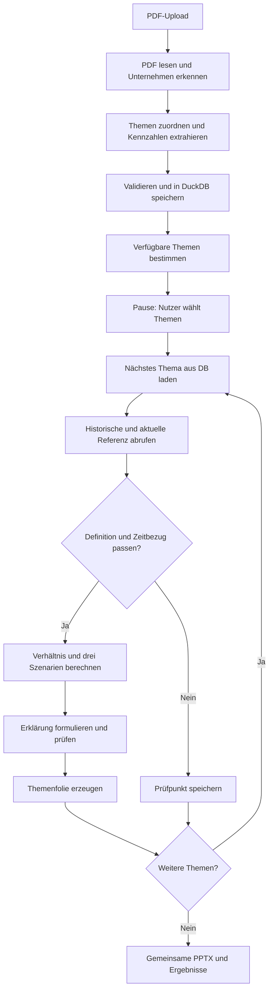

# Stadtwerke-Ausblick: festgelegter MVP-Workflow

Stand: 6. Oktober 2026. Der folgende Ablauf beschreibt das vom Nutzer gewählte Konzept. Die Anwendung ist noch nicht implementiert. Schnittstellen wurden bereits recherchiert und getestet: [Quellenkatalog](docs/API_QUELLEN.md), `data/reference_catalog.json`.

## 1. Ziel und Grundmodell

PDF hochladen → Bericht nach Sparten gliedern und Kennzahlen speichern → Nutzer wählt Themen → historische und aktuelle Referenzen abrufen → Unternehmenswerte bei konstantem Verhältnis fortschreiben → drei Szenarien und eine PowerPoint-Folie je Thema erzeugen.

```text
U_basis = belegter Unternehmenswert im Berichtsjahr
R_basis = vergleichbarer Referenzwert desselben Zeitraums/Stichtags
R_ziel  = Referenzwert des Zielzeitraums/Stichtags

q = U_basis / R_basis
U_erwartung = q × R_ziel
             = U_basis × R_ziel / R_basis

delta_referenz = R_ziel − R_basis
delta_unternehmen = q × delta_referenz
```

Bei vergleichbarer Größe und gleicher Einheit ist `100 × q` ein prozentualer Anteil beziehungsweise ein Preis-/Zinsverhältnis. Erfundenes Beispiel: Unternehmen 10 MW, Deutschland 1.000 MW → Anteil 1 %; Deutschland später 1.300 MW → Unternehmensschätzung 13 MW. Die nationale Summe ist kein durchschnittliches Stadtwerk.

Das Ergebnis ist eine Fortschreibung unter konstantem Verhältnis, kein beobachteter aktueller Unternehmenswert. Ein einzelnes Berichtsjahr begründet keine statistisch geschätzte Unternehmensentwicklung. Zusätzliche Treibermodelle ersetzen die Grundrechnung im ersten MVP nicht.

## 2. PDF analysieren und in der Datenbank speichern

1. **Upload übernehmen:** PDF lokal speichern, Hash und Dokument-ID vergeben; bereits analysierte Dateien wiederverwenden.
2. **Seiten lesen:** Text, Tabellen, Tabellenköpfe, Kontext und physische Seitenzahlen erfassen. Unlesbare PDFs erhalten einen OCR-Hinweis; OCR ist zunächst kein garantierter Bestandteil.
3. **Berichtsrahmen erkennen:** Unternehmen, Gesellschaft/Konzern, Geschäftsjahr, Zeiträume und Stichtage erfassen. Unternehmenssitz, Anlagenstandorte, Vertriebsgebiet und Netzgebiet unterscheiden.
4. **Themen zuordnen:** Abschnitte und Tabellen nach PV-Ausbau, PV-Stromertrag, Wind-Ausbau, Speicher, Stromvertrieb, Gas, Wärme, Ladegeschäft und Finanzierung gliedern. Eine Seite kann mehrere Themen enthalten; die PDF wird logisch zugeordnet, nicht zwingend in einzelne Dateien zerlegt.
5. **Kennzahlen extrahieren:** Relevante Kandidaten vor der Nutzerfrage erfassen, einschließlich belegter Vorjahreswerte. Originalzahl, Originaleinheit, normalisierte Einheit, Zeitbezug, Berichtsebene, Seite und Belegtext speichern.
6. **Prüfen:** Vorjahresspalten, Einheiten, Konzern-/Segmentwerte und Kennzahldefinitionen abgleichen. Eigene Anlagen, Beteiligungen und Anlagen im Netzgebiet nicht vermischen; Absatz und Netzmenge unterscheiden. Fehlendes bleibt fehlend, Konflikte bleiben Prüfbedarf.
7. **DuckDB befüllen:** Dokument, Themen, Kandidaten, verwendbare Werte und Hinweise persistieren. Erst danach entsteht die Themenauswahl.

Ein weiterer Analyseauftrag nutzt dieselben gespeicherten Berichtsdaten. Unklare Werte dürfen gezielt im PDF nachgeschlagen werden; das ganze Dokument wird nicht erneut vollständig extrahiert.

## 3. Nutzerfrage und Themenfreigabe

Die Oberfläche zeigt eine kurze Spartenübersicht und **„Was interessiert dich besonders?“** Ein oder mehrere Themen sind auswählbar. Jede Option nennt die konkrete Zielgröße, beispielsweise „PV-Ausbau — Leistung in MWp“ oder „Stromvertrieb Haushalte — Durchschnittspreis“.

Freigabe verlangt zugleich:

- einen belegten verwendbaren Unternehmenswert;
- eine freigegebene Schnittstelle mit passenden historischen und aktuellen Daten;
- kompatible Definition, Einheit, Berichtsebene und zeitlichen Bezug;
- eine zulässige Fortschreibungsregel für diese Unternehmens-Referenz-Paarung.

Nicht jede gefundene Sparte ist berechenbar. Fehlende Voraussetzungen werden erklärt; keine Auswahl mit erfundenen Daten. Der Quellenkatalog enthält Kandidaten und bestätigt deren Schnittstellen, nicht pauschal alle möglichen Kennzahlenpaarungen.

Nach der Speicherung pausiert LangGraph mit `interrupt()`. Die Auswahl wird validiert und mit `Command(resume=...)` unter derselben `thread_id` fortgesetzt. Ein persistenter Checkpointer hält den Ablaufzustand. Datenbankschreibvorgänge liegen in einem separaten vorangehenden Knoten: Der Interrupt-Knoten kann beim Resume erneut beginnen, ohne Duplikate anzulegen.

## 4. Referenzen abrufen und rechnen

Pro gewähltem Thema:

1. Unternehmenskennzahl aus DuckDB laden.
2. Quelle, Serie, Region, Basispunkt und Zielpunkt aus dem freigegebenen Themenvertrag bestimmen.
3. Historische Referenz des tatsächlichen Berichtsjahrs laden. Verfügbare Folgejahre ergänzen die Referenzentwicklung; 2025 ist für eine reine 2024→2026-Rechnung keine zwingende Voraussetzung.
4. Aktuelle Referenz des Zieljahrs laden. Anfrage, Originalantwort, Daten-/Abrufstand, Revision und Lizenzhinweis speichern.
5. Nullwerte, Kennzeichen, Einheiten, Vollständigkeit und Zeitraster prüfen; passende Referenzgrößen aggregieren.
6. `q = U_basis / R_basis` und `U_erwartung = q × R_ziel` deterministisch berechnen.
7. Ergebnis und verwendete Belege speichern.

Die Quellenadapter nutzen feste freigegebene Endpunkte. Das LLM erfindet keine Schnittstellen. Ein Ersatz ist nur bei dokumentierter kompatibler Definition zulässig; Regionswechsel offen kennzeichnen. Fehlende Daten, Nullnenner oder ungeklärte Vergleichbarkeit führen zu einem Prüfpunkt. Andere gewählte Themen können weiterbearbeitet werden.

## 5. Drei Szenarien

| Szenario | Rechnung | Aussage |
|---|---|---|
| Erwartung | `q × R_ziel` | Verhältnis zum Referenzmarkt bleibt wie im Berichtsjahr |
| Niedrigeres Verhältnis | `q × R_ziel × (1 − s)` | Wert liegt unter der zentralen Fortschreibung |
| Höheres Verhältnis | `q × R_ziel × (1 + s)` | Wert liegt über der zentralen Fortschreibung |

`s` beträgt zunächst konfigurierbare 10 %. Das ist ein gewählter Szenarioabstand, kein statistisches Konfidenzintervall. Beim erfundenen Beispiel ergeben sich 11,7 / 13,0 / 14,3 MW. Der Abstand bezieht sich auf den zentralen geschätzten Unternehmenswert, nicht auf dessen Wachstumsrate oder Prozentpunkte des Anteils.

Bei Absatz/Ausbau kann „höher“ positiv interpretiert werden; bei Kosten/Zinsen nicht automatisch. Ohne tatsächlichen aktuellen Unternehmenswert zeigt die Anwendung, welcher Wert die Erwartung übertreffen würde. Sie behauptet nicht, dass das Unternehmen sie bereits übertroffen hat.

## 6. Zeitbezug des laufenden Jahres

**Bestände:** Berichtsstichtag mit passendem Referenzstichtag vergleichen. Der aktuelle Referenzbestand ergibt eine Unternehmensschätzung zu diesem Datenstand, keinen bereits beobachteten Jahresendbestand. Vorläufige aktuelle Monate nicht als abgeschlossen behandeln.

**Mengen:** Jahresmengen mit Jahresmengen vergleichen, nicht Unternehmensjahresmenge mit Referenz-Wochenwert oder Teiljahr als angeblich vollständigem Jahr. Zwei zulässige Ausgaben:

- Bis zum Datenstand: `q_gesamtjahr × R_ziel_bisher`. Das konstante Jahresverhältnis unterjährig anzuwenden ist eine sichtbare zusätzliche Saisonannahme. Ergebnis bleibt eine geschätzte Unternehmens-YTD-Menge.
- Jahresendszenario: Referenz erst auf ein Gesamtjahr ergänzen. Erste MVP-Methode: `R_ziel_bisher + R_basis_rest × (R_ziel_bisher / R_basis_gleicher_zeitraum)`. Damit wird die bisherige Referenzänderung auf entsprechende Restmonate/-wochen des Basisjahrs übertragen. Diese Annahme und Jahresrandbehandlung nennen; dann die ursprüngliche Verhältnisrechnung anwenden.

**Preise/Zinsen:** Vergleichbare Mittelwerte bilden, keine Summen. Ein Januar–August-Mittel als solches ausweisen. Für Jahresende eine eigene Restjahrannahme, z. B. letzten Monatswert konstant halten, und geeignete Gewichtung dokumentieren.

Geschäftsjahre folgen tatsächlichem Beginn/Ende. Quartalsbestände am 1. Januar 2025 passen näherungsweise zum 31. Dezember 2024; den Unterschied ausweisen. Zwischen einem Berichtsjahreswert und der Schätzung keine scheinbar beobachtete Unternehmenskurve erzeugen.

## 7. Themen und fachlich passende Referenzen

| Berichtsthema | Zielgröße | Freigaberegel |
|---|---|---|
| PV-Ausbau | MWp/DC oder MW/AC | Energy-Charts: gleichartige nationale Leistung |
| Wind-Ausbau | MW, onshore/offshore | Energy-Charts: gleiche Anlagenart |
| Batteriespeicher | MW und/oder MWh | Energy-Charts: Leistung und Energieinhalt separat |
| Gasabsatz kleine Verbraucher | MWh/GWh | BNetzA SLP: passende Energiemenge aus Wochenmittelwerten bilden |
| Gasabsatz große Verbraucher | MWh/GWh | BNetzA RLM: Kunden- und Verbraucherumfang abgleichen |
| Stromvertrieb Haushalte | Vergleichbarer Durchschnittspreis | SMARD: Preisverhältnis, kein Mengen-/Marktanteil |
| Stromvertrieb Industrie | Vergleichbarer Durchschnittspreis | SMARD: Vergünstigung und Kundengruppe berücksichtigen |
| Gasvertrieb Haushalte | Vergleichbarer Durchschnittspreis | SMARD: Abgabenbasis und Kundengruppe angleichen |
| PV-Stromertrag | MWh | Nationale PV-Erzeugungsreihe und vollständige Zeitabdeckung zusätzlich prüfen; Wetter ist keine gleichartige MWh-Referenz |
| Wärmeabsatz | MWh | Direkte Wärmemengenreferenz noch nicht verifiziert; Temperatur ist ein anderer Referenztyp |
| Ladegeschäft | Ladepunkte / Ladestrom | Fahrzeugbestand aus KBA ist keine gleichartige Ladepunkt- oder Energiereferenz |
| Finanzierung | Vergleichbarer effektiver Zinssatz | Bundesbank/EZB: Zinsverhältnis möglich; Schulden/Zinsaufwand sind keine Prozentanteile am Referenzzinssatz |
| Strombeschaffung | Vergleichbarer Beschaffungspreis | Day-ahead-Referenz nur für fachlich kompatible Preisexposition |

Für **Stromvertrieb an Privatkunden in kWh** wurde bislang keine passende aktuelle/historische nationale Haushalts-Absatzreihe verifiziert. Die vorhandenen SMARD-Daten ermöglichen zunächst einen **Preisvergleich**. Umsatz benötigt zusätzlich eine getrennte Mengenannahme und passende Preis-/Umsatzabgrenzung. Gesamtdeutscher Stromverbrauch ersetzt keine Haushaltsvertriebsreihe.

Wetter und Fahrzeugzahlen bleiben mögliche Zusatzreferenzen. Sie ersetzen im festgelegten ersten MVP keine fehlende gleichartige Menge. Berichtsthemen werden auch dann gespeichert, wenn ihre direkte Verhältnisfortschreibung noch nicht freigegeben ist.

## 8. LangGraph-Kontrollfluss



Kontrollierte Rückwege: unklare Extraktion → relevante PDF-Seiten erneut lesen, maximal zwei Nachrecherchen; ungültige Auswahl → gültiges Menü; temporärer Quellenfehler → begrenzter Retry mit `Retry-After`; sprachlicher Fehler → einmal überarbeiten oder Textvorlage. Widersprüchliche Fachwerte bleiben Prüfbedarf.

Das LLM kann strukturiert vorschlagen, welche Kennzahl/Belegstelle nachzuschlagen ist. Python validiert die Aktion und begrenzt die Werkzeuge. Quellenfreigabe und Rechnung folgen Themenverträgen. Der Ablauf enthält eine echte Nutzerentscheidung und fachliche Verzweigungen, keine beliebige autonome Recherche.

## 9. Aufgaben und Datenhaltung

| Baustein | Aufgabe |
|---|---|
| LangChain + Ollama | Themen-/Unternehmenszuordnung, strukturierte Extraktion, gezielte Belegsuche, Formulierung aus geprüften Ergebnissen |
| LangGraph | Reihenfolge, Zustand, Verzweigungen, Wiederholungen, Nutzerpause/Resume, Schleife über Themen |
| Python | PDF-/Tabellenzugriff, Einheiten, Quellenadapter, Aggregation, fachliche Freigabe, alle Rechnungen und Exporte |
| DuckDB | Fachliche Daten, Belege, Nutzerwahl, Referenzen und Szenarien |
| Persistenter Checkpointer | Graphzustand einschließlich offener Frage; lokale SQLite-Datei separat von DuckDB |
| Streamlit | Upload, Fortschritt, Mehrfachauswahl, Vorschau und Downloads |
| python-pptx | Bearbeitbare Folien und gemeinsame Präsentation |

Geplant: Python 3.12, Pydantic, pdfplumber, langchain-core, langchain-ollama, langgraph, Ollama, DuckDB, Streamlit, python-pptx. Versionen beim Implementierungsstart prüfen und festschreiben. Modellkandidat `qwen2.5:7b` an echten Berichtsseiten testen. Bislang gefunden: Python 3.9.6; Ollama/uv nicht im PATH. Anwendungssystem noch nicht startbereit.

| Tabelle / Speicher | Inhalt |
|---|---|
| `companies`, `documents` | Unternehmen, Berichtsebene, Geschäftsjahr, Datei und Hash |
| `document_sections`, `report_topics` | Seiten-/Tabellenkontext und Themenzuordnungen |
| `kpi_observations` | Roh-/Normwert, Einheit, Definition, Zeitbezug, Seite, Beleg, Prüfstatus |
| `analysis_sessions`, `topic_selections` | Zieljahr, gewählte Themen, Reihenfolge, Szenarioabstand |
| `reference_requests`, `reference_observations` | Anfrageparameter, Rohantwort, Hash, Datenstand, Serie/Region und Beobachtungen |
| `comparison_results`, `scenario_results` | Ausgangswerte, Verhältnis, Zeitabgleich, Restjahrannahmen und Szenarien |
| `review_items`, `decision_events` | Konflikte, Ausschlüsse, Nachrecherche und Entscheidungen |
| `slide_artifacts` | Themen-/Lauf-ID, Quellen-IDs, Reihenfolge und Ausgabepfade |
| Checkpoint-SQLite | Technischer Ablaufzustand und Wiederaufnahme über `thread_id` |

Alle Ergebnisse verweisen auf ihre Belege. Beobachtungen und Schätzungen bleiben getrennt. Persistenz ist idempotent: Wiederaufnahme erzeugt keine doppelten Daten oder Folien. Das Modell erhält Dokumentausschnitte als Daten; darin enthaltene Handlungsanweisungen steuern keine Werkzeuge.

## 10. Eine Folie je Thema

Vorläufiges Layout:

- Titel: Unternehmen, Thema, Zieljahr/Datenstand.
- Links: belegter Berichtswert, historische Referenz, daraus berechnetes Verhältnis.
- Mitte: aktuelle Referenz und Veränderung; optional tatsächliche Referenzentwicklung als Linie.
- Rechts: drei Szenariowerte als Balken, zentrale Fortschreibung hervorgehoben.
- Darunter: ein kurzer Satz zur Bedeutung.
- Fußzeile: PDF-Seite, Quellen, Datenstand, konstantes Verhältnis, Szenarioabstand und Restjahrannahme.

Numerische Werte setzt Python ein. Das LLM formuliert nur aus dem geprüften Ergebnisobjekt; ein Prüf-Knoten kontrolliert Zahlen-/Quellenbezüge. Aktuelle Unternehmenswerte sind durchgehend „geschätzt“. Keine unbelegten Ursachen ergänzen.

Ein Thema → eine native bearbeitbare Inhaltsfolie. Mehrere Themen → dieselbe Vorlage mehrfach in einer gemeinsamen PPTX in Nutzerreihenfolge. Einzelne Themenfolien auch separat als PPTX bereitstellen. Titel-/Methodikfolie optional. HTML-Vorschau, JSON und CSV dienen als nachvollziehbare Begleitausgaben. PowerPoint vor Auslieferung rendern und visuell prüfen.

## 11. Implementierungsreihenfolge und Abnahme

1. Laufzeit, Projektgerüst und echter lokaler Modellaufruf; Quellen-/Themenverträge laden.
2. PDF-Upload, Themenzuordnung, belegte Extraktion und DuckDB an einem realen Bericht.
3. Persistenter Graph mit Nutzerpause und Mehrfachauswahl; Resume ohne erneute Vollanalyse demonstrieren.
4. Eine vollständig passende Sparte mit echten historischen/aktuellen Abrufen. PV-Leistung wählen, wenn im Demobericht getrennt vorhanden; sonst eine andere belegte passende Sparte.
5. Verhältnisrechnung, drei Szenarien und korrekten Zeitbezug prüfen.
6. Eine Themenfolie und Gesamtpräsentation erzeugen, rendern und visuell prüfen.
7. Weitere kompatible Sparten ergänzen; fehlende Referenzverträge vor Freigabe lösen.

Kein neuer fester Tageszeitplan vor der Modell-/PDF-Probe. Eine Peer-Datenbank mit fünf Unternehmen ist für diesen nationalen/regionalen Referenzansatz keine Voraussetzung.

Fertig ist der erste MVP, wenn ein echter Bericht gespeichert wird, danach eine zulässige Auswahl erscheint und mindestens eine Sparte vollständig mit echten Quellen, Rechnung und drei Szenarien als geprüfte PPTX ausgegeben wird. Mehrfachauswahl, Resume, fehlende Quellen und Wiederholung ohne Duplikate müssen funktionieren. Quellen-/Datenstand, Formel, Einheit und Schätzannahmen bleiben sichtbar.

Notwendige Checks: Zahlen/Jahr/Seite gegen manuell geprüfte Berichtsausschnitte; MW vs. MWh, Netto-/Bruttobasis; 10/1.000×1.300=13 und ±10 %; Jahreswert vs. YTD; Gewichtung bei wechselnden Zeitschritten; Nullnenner; fehlende/gesperrte KBA-Werte; Interrupt/Resume; mehrere Themen und Foliensortierung. Künstliche Testfälle ersetzen keinen echten Demolauf.

## Technische Grundlagen

- [LangGraph: Interrupts und Resume](https://docs.langchain.com/oss/python/langgraph/interrupts)
- [LangGraph: Persistenz und Checkpointer](https://docs.langchain.com/oss/python/langgraph/persistence)
- [LangChain: strukturierte Ausgaben](https://docs.langchain.com/oss/python/langchain/structured-output)
- [ChatOllama-Integration](https://docs.langchain.com/oss/python/integrations/chat/ollama)

Die Dokumentation belegt Framework-Funktionen. Der konkrete Anwendungslauf, Extraktionsqualität und Folienexport sind noch zu implementieren und zu testen.
