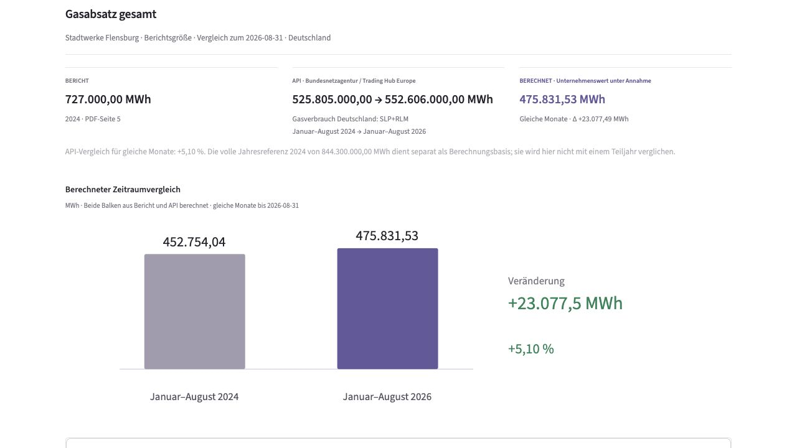
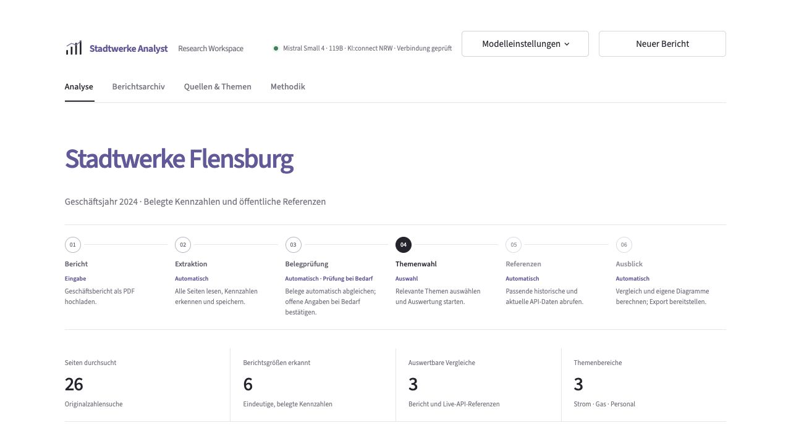
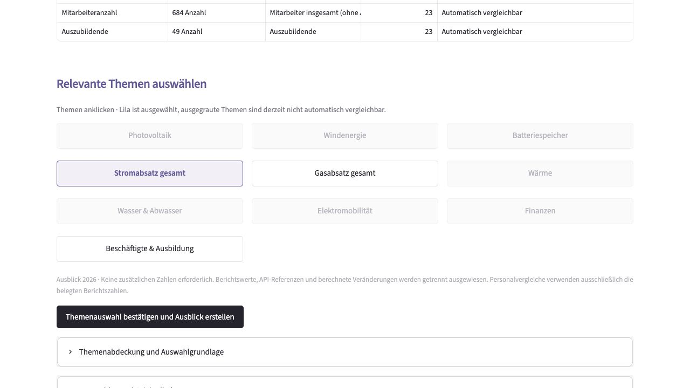
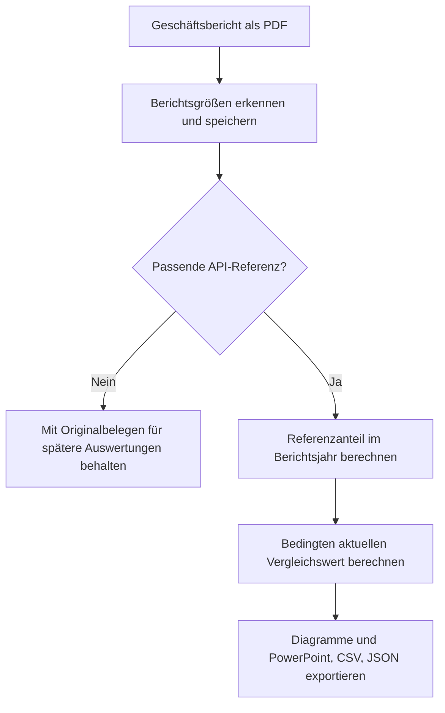

# Stadtwerke Analyst

[](https://github.com/rarriracer/StadtwerkBenchmark/actions/workflows/tests.yml)

Ein lokaler Prototyp für die KI-gestützte Auswertung von Geschäftsberichten: belegte Kennzahlen erfassen, öffentliche API-Referenzen verknüpfen und nachvollziehbare Vergleiche als editierbare PowerPoint exportieren.

Das Projekt verbindet ein fachliches Problem der Energiewirtschaft mit Python, strukturierten KI-Ausgaben, Datenbankspeicherung und einem wiederaufnehmbaren Analyseworkflow. Die Entwicklung erfolgt mit KI-Unterstützung; Originalbelege und Rechenregeln werden unabhängig von Modellantworten geprüft.

## Einblick



<details>
<summary>Berichtserfassung und Themenauswahl ansehen</summary>





</details>

## Direkt ausprobieren

**Fünf vorbereitete Beispiele** sind nach dem Start im Berichtsarchiv verfügbar: Flensburg, Karlsruhe, Leipzig, Münster und Solingen. Zum Öffnen und Prüfen dieser Berichte ist kein KI-Schlüssel erforderlich. Für aktuelle Referenzdaten wird Internet benötigt.

Auf GitHub **Code → Download ZIP** wählen und das ZIP in einen eigenen Ordner entpacken. Alternativ:

```sh
git clone https://github.com/rarriracer/StadtwerkBenchmark.git
cd StadtwerkBenchmark
```

Voraussetzung ist [uv](https://docs.astral.sh/uv/getting-started/installation/). Der folgende Einrichtungsbefehl stellt bei Bedarf auch Python 3.12 bereit. Die Befehle im entpackten Projektordner ausführen:

```sh
uv sync --frozen --python 3.12
uv run python scripts/start_app.py
```

Die Oberfläche öffnet sich unter **http://127.0.0.1:8501/**. Alternativ nach der Einrichtung unter macOS `Stadtwerke starten.command` oder unter Windows `Stadtwerke starten.cmd` öffnen. Die Windows-Ersteinrichtung übernimmt `Windows einrichten.cmd`; [Anleitung](docs/WINDOWS.md).

Für einen ersten Durchlauf **Berichtsarchiv → Stadtwerke Flensburg → Bericht öffnen → Gasabsatz auswählen → Themenauswahl bestätigen und Ausblick erstellen** verwenden. Anschließend lassen sich PowerPoint, CSV und JSON herunterladen. Dafür ist kein KI-Schlüssel nötig; die Referenzen werden über öffentliche APIs abgerufen. Für eine neue PDF-Analyse unter **Modelleinstellungen** OpenRouter, KI:connect NRW oder ein lokales Ollama-Modell konfigurieren. Cloud-Schlüssel werden ausschließlich lokal gespeichert. Ein lokales Modell ist beim Start mit einem Cloud-Anbieter nicht erforderlich.

### Wenn etwas nicht funktioniert

- **uv nicht gefunden:** uv installieren und ein neues Terminal öffnen.
- **Seite nicht erreichbar:** den Startbefehl im Projektordner erneut ausführen; die App muss lokal laufen.
- **API nicht erreichbar oder aktueller Zeitraum fehlt:** das Programm zeigt den betroffenen Vergleich als Fehler. Bereits gespeicherte Originalbelege bleiben verfügbar.
- **Neue PDF-Analyse nicht verfügbar:** zuerst einen Anbieter mit eigenem Schlüssel oder ein installiertes Ollama-Modell konfigurieren. Eine unvollständige KI-Auswertung wird ausdrücklich angezeigt.
- **Weitere Details:** [Windows-Einrichtung](docs/WINDOWS.md), [KI:connect](docs/KICONNECT.md), [OpenRouter](docs/OPENROUTER.md). Laufzeitfehler stehen lokal in `data/runtime/app.log`.

## Ablauf



- **Quellengebundene Erfassung:** sichtbare PDF-Seiten, Tabellen und eindeutig beschriftete Jahresdiagramme; Kennzahlen behalten Zahl, Einheit, Jahr und Originalseite.
- **Strukturierte KI-Auswertung:** OpenRouter, KI:connect NRW oder Ollama unterstützen die Erfassung. Nicht nachgewiesene oder widersprüchliche Angaben werden nicht automatisch verwendet.
- **Wiederaufnehmbarer Workflow:** LangGraph hält vor der Themenwahl an; erfolgreiche Seiten und Analysen werden lokal gespeichert.
- **Klare Herkunft:** Berichtszahlen, öffentliche API-Daten und berechnete Unternehmenswerte stehen getrennt nebeneinander.
- **Automatische Themenwahl:** verfügbare Themen sind anklickbar, ausgewählte lila und nicht verfügbare ausgegraut. Es werden keine zusätzlichen Mengen oder Finanzierungsannahmen abgefragt.
- **Nachvollziehbarer Export:** native editierbare PowerPoint-Diagramme, CSV-Vergleichswerte und JSON mit Belegen, Quellen und Annahmen.

## Vergleich und Grenzen

Anlagenbestände werden unter der Annahme eines konstanten Referenzanteils verglichen. Strom- und Gasmengen werden für **dieselben verfügbaren Monate** gegenübergestellt. Die historische Jahressumme bleibt eine separate Berechnungsbasis. Ein Teiljahr wird nicht als vollständiges Jahr oder Jahresendprognose dargestellt.

Der berechnete Wert ist ein **bedingter Modellvergleich**, keine gemessene aktuelle Unternehmenszahl. Die Relation zur nationalen Referenz ist nicht in jedem Fall ein exakt abgegrenzter Marktanteil. Gewinn und Cashflow werden nicht pauschal mit Marktpreisen hochgerechnet. Der Day-Ahead-Preis wird im normalen Mengenvergleich nicht angezeigt.

Eine erkannte Berichtsgröße muss nicht automatisch vergleichbar sein. Angaben ohne passende Referenz werden mit ihren Belegen gespeichert. Beschäftigte und Ausbildung bilden einen Berichtvergleich; eine Ausbildungsquote wird nur bei eindeutig passender Abgrenzung berechnet. Die ergänzende KI-Erfassung kann unvollständig sein. Modell-, OCR- und Layoutfehler bleiben sichtbar und prüfbar.

**Acht Quellenfamilien** sind angebunden: Energy-Charts, SMARD, Bundesnetzagentur-Gas, Open-Meteo, Bundesnetzagentur-Ladeinfrastruktur, KBA, Bundesbank mit EZB-Ersatzquelle und Eurostat. Eine verfügbare API allein begründet noch keinen Unternehmensvergleich. Quellen, Voraussetzungen und Datenstände: [Unternehmensvergleiche](docs/UNTERNEHMENSVERGLEICHE.md), [API-Katalog](docs/API_QUELLEN.md).

## Technik

| Bereich | Umsetzung |
|---|---|
| Oberfläche | Streamlit, eigenes CSS, SVG-Diagramme |
| Dokumente | pdfplumber, pypdfium2, RapidOCR |
| KI und Ablauf | Pydantic, LangChain, LangGraph; OpenRouter, KI:connect oder Ollama |
| Speicherung | DuckDB für Berichtsdaten, SQLite für Workflow-Zustände |
| Referenzen | Öffentliche JSON-/CSV-/XLSX-Schnittstellen mit Abrufzeit und Prüfsumme |
| Ausgabe | python-pptx, CSV und JSON |

## Tests und Veröffentlichung

```sh
uv run pytest -q
uv run python scripts/check_publish.py
```

Die Tests nutzen isolierte Modelleinstellungen und benötigen keinen persönlichen KI-Schlüssel. Einige Prüfungen ganzer zusätzlicher Testberichte werden übersprungen, wenn diese lokal nicht vorliegen. Ein bestandener Regressionstest bestätigt keine vollständige fachliche Erfassung jedes beliebigen Berichts.

`.gitignore` schließt Zugangsdaten, lokale Datenbanken, Caches, zusätzliche Uploads und Ausgaben aus. Der Veröffentlichungscheck prüft die Git-Dateiauswahl, die fünf Beispielberichte und bekannte lokale Zugangsdaten, ohne Schlüssel auszugeben. [GitHub-Vorbereitung](docs/GITHUB.md).

## Projektstruktur

- `app.py`: Oberfläche und Auswahl
- `src/stadtwerke/`: Erfassung, Belegprüfung, Workflow, Referenzen und Export
- `assets/`: Gestaltung
- `data/examples/`: portable, vorbereitete Beispielanalysen
- `Geschäftsberichte/Beispiele/`: die fünf Originalberichte; [Quellenübersicht](Geschäftsberichte/00_Uebersicht.md)
- `tests/`: Regressionstests und kleine Quellen-/Layoutausschnitte
- `docs/`: Methodik, Anbieter und Einrichtung
- `data/runtime/`, `data/raw/`, `outputs/`: ausschließlich lokale Laufzeitdaten, vom Git-Upload ausgeschlossen
